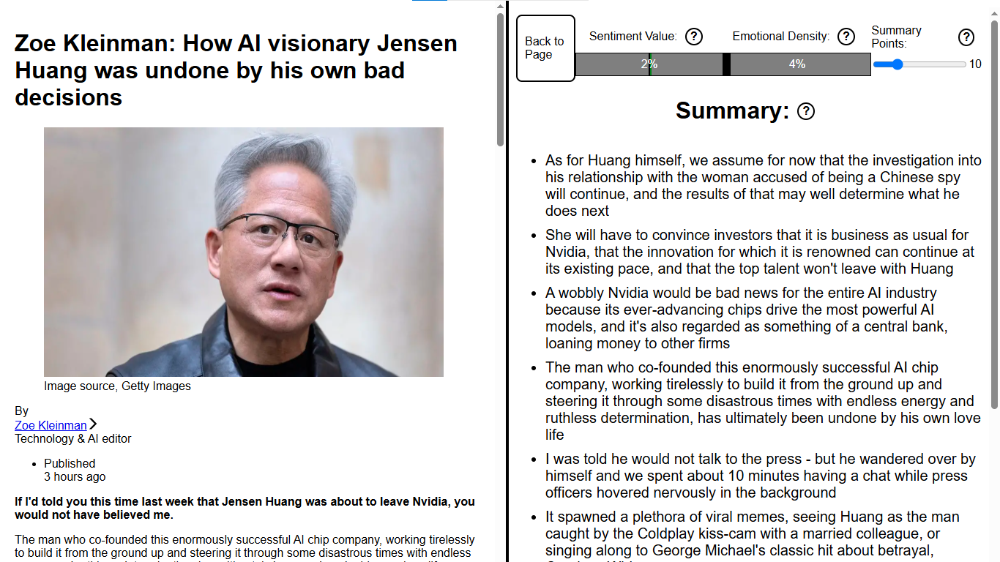

# University Capstone Project

### Description

This university project was decided for my final year project. The topic was Text-Summarisation for News Articles.

The program works by the user entering a URL to a news website. The web server then proxys the HTML content from the URL. The text then gets scraped off of the page and then processed to produce a list of bullet points to summarise the article.

The summarisation takes all the sentences and splits them into words. Each word is ranked on how frequently it is shown throughout the text. Using these frequencys the sentences are then ranked based on the words that they have. The sentences with the most common words will best summarise the text. 

This project uses a web server so to allow different news websites to allow the connection. There was a problem where the news outlets would deny any access. Using the server as a proxy allows the user to still see the content. Server also allows you to type 

"localhost:3000?url="

at the start of any url to instantly load up the summarisation page.

To better help the user identify if the text is factual or not there is a sedimental analysis applied to the article. A large file containing words and a number representing their sentimental value, is used against all the words in the article. A total score is then calculated and shown as a percentage. Positive numbers corrolate to a more positive tone.

Page is split into a page where you can see the original article with removed bloat. On the other side is a list of points which are directly used from the website. Clicking on the points will scroll the to the text contained in the article.

### Usage

Ensure that you have Node.js initialised on your computer. install socket.io.

npm install socket.io

Clone this repositiory into your own directory. Open a terminal at project directory

node index.js

will run the program. Keeping the terminal open will allow the program to run. In the browser go into the localhost at the port specified in the console.

localhost:3000

